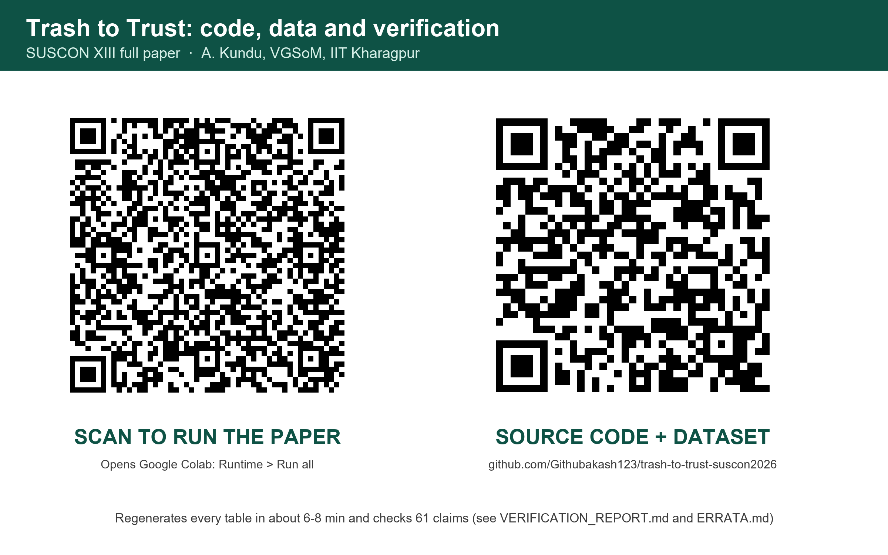

# Trash to Trust: code, data and verification

[](https://github.com/Githubakash123/trash-to-trust-suscon2026/actions/workflows/reproduce.yml)
[](https://colab.research.google.com/github/Githubakash123/trash-to-trust-suscon2026/blob/main/notebooks/run_in_colab.ipynb)
[](https://mybinder.org/v2/gh/Githubakash123/trash-to-trust-suscon2026/main?labpath=notebooks%2Frun_in_colab.ipynb)
[](LICENSE)

Code and dataset for the SUSCON XIII full paper *Trash to Trust: Layer-Wise Validation of an Integrated Decision Framework for Circular and Equitable Municipal Solid Waste Management in India* (Akash Kundu, Vinod Gupta School of Management, IIT Kharagpur). One command regenerates every table behind the paper and checks each of the paper's 61 quantitative and methodological claims against the regenerated output.

<p align="center"></p>

## Run it

**In the browser, nothing to install.** Scan the left QR code, or click *Open in Colab* above, then choose **Runtime → Run all**. The notebook clones this repository (the dataset is inside it), installs the pinned environment, runs everything in about 6–8 minutes, and prints the verification report.

**Locally** (Python 3.12 or later):

```bash
git clone https://github.com/Githubakash123/trash-to-trust-suscon2026.git
cd trash-to-trust-suscon2026
pip install -r requirements.txt
python reproduce.py
```

`reproduce.py` exits 0 on PASS and 1 on FAIL. `python reproduce.py --verify` re-checks the claims on existing outputs without recomputing them.

**Continuous check.** Each push, and a monthly scheduled job, run the full reproduction on a clean Ubuntu machine. A second job executes the Colab notebook end to end. The badge at the top shows the latest result, and each run's report and outputs are attached to it.

## What `reproduce.py` does

| Step | What runs | Output |
|---|---|---|
| 0 | Dataset SHA-256 check against the file the paper used | stops on mismatch |
| 1 | `circular_msw_pipeline.py`: 9 stages (harmonise, indicators, panel, ARDL fallback, TOPSIS, scenarios, LP allocation, clusters, forecasting) | `outputs/pipeline/` |
| 2 | `analysis/run_all.py`: SD calibration and identifiability, PCI, LCA Monte Carlo, RL and OPE, walk-forward forecasting and conformal intervals, routing, MCDM stability, ablations and propagation | `outputs/` (30 tables) |
| 3 | `verification/extra_checks.py`: pooled-mean baseline (V2), data and unit audit | `outputs/verification_*.csv` |
| 4 | Compare all 30 tables with the run behind the paper | `outputs/run_manifest.json` |
| 5 | `verification/verify_claims.py`: every paper claim checked | `VERIFICATION_REPORT.md`, `outputs/claims_check.csv` |

`verification/check_provenance.py` confirms that the analysis code and the dataset are byte-identical to the commit that produced the paper (see [PROVENANCE.md](PROVENANCE.md)).

## Result of the reference run

On Windows 11 with Python 3.14.6, the run takes 5.1 minutes. All **30 of 30** analysis tables are byte-identical to the paper's run, and **61 of 61** claims land in their documented status:

| Status | Claims | Meaning |
|---|---:|---|
| REPRODUCED | 32 | Number regenerates and the paper describes it correctly |
| REPRODUCED_WITH_CORRECTION | 16 | Number regenerates; the paper's unit, scope or method description needs the correction in ERRATA.md |
| NOT_SUPPORTED | 11 | The code does not do what the paper's methods text says |
| LEGACY_ONLY | 2 | The number exists only in a pre-pipeline Colab output that no code here regenerates |

A **PASS** means the paper's numbers are reproduced and every known discrepancy is documented. It does not mean every sentence of the paper is correct. Read **[ERRATA.md](ERRATA.md)** before reusing any result. The most important corrections:

- **Units.** Table 3's MAE is in t/day summed over five streams, not t/year. The MAE is pooled over 102 city-years, not over one final year.
- **V2 holds, and is computed here.** On the paper's own walk-forward folds, the pooled mean (MAE 5,409) beats gradient boosting (5,869), and boosting's walk-forward R² is −0.23.
- **The 7.8 % GHG reduction (V8)** is an assumed coupling coefficient (triangular 0.45 / 0.60 / 0.75) multiplied by the circularity gain. It is not propagated through the LCA factors.
- **Goal programming, informal-employment goal, Indore 40/35/25, the R² = 0.26 split, fuzzy TOPSIS, the four-stock SD model, and RL baseline dominance** have no implementation in this code.
- **The dataset is synthetic in every quantitative field.** It is a testbed with known-noise ground truth, not a measurement of Indian cities.

## Repository layout

```
reproduce.py                    one-command run + verification
circular_msw_pipeline.py        9-stage pipeline           } unchanged from source
analysis/                       8 validation modules       } commit 1f5883c
Waste_Management_and_Recycling_India.csv   dataset (MIT, Krishna Yadu, Kaggle)
verification/                   extra checks, claim checker, provenance checker
reference/paper_run_1f5883c/    the 30 tables the paper was written from
reference/legacy_colab_a70d27d/ older Colab outputs (audit only; no generating code)
notebooks/run_in_colab.ipynb    the notebook the QR code opens
qr/                             QR codes (PNG, SVG) and a printable card (PNG, PDF)
ERRATA.md  PROVENANCE.md  VERIFICATION_REPORT.md  CITATION.cff
```

## Data

`Waste_Management_and_Recycling_India.csv`: *Waste Management and Recycling in Indian Cities*, Krishna Yadu, Kaggle, MIT licence: <https://www.kaggle.com/datasets/krishnayadav456wrsty/waste-management-and-recycling-in-indian-cities>. It contains 850 rows (34 cities × 5 waste streams × 2019–2023) and is redistributed unchanged.

## Citation

See [CITATION.cff](CITATION.cff). Cite the paper, this repository, and the Kaggle dataset.

## Licence

Code: MIT © 2026 Akash Kundu. Dataset: MIT © its author (see above).
